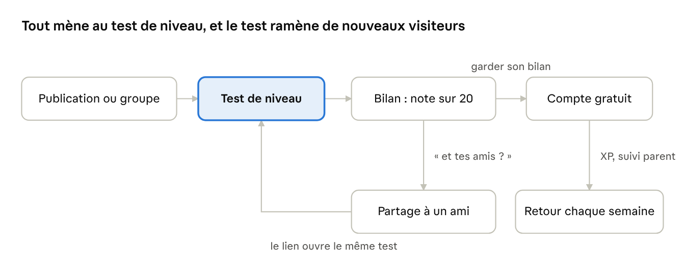
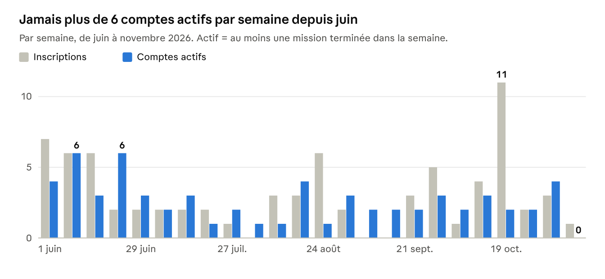
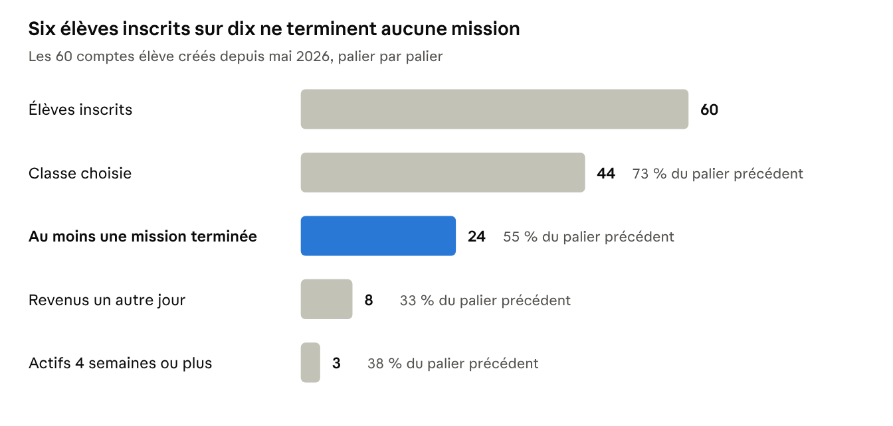
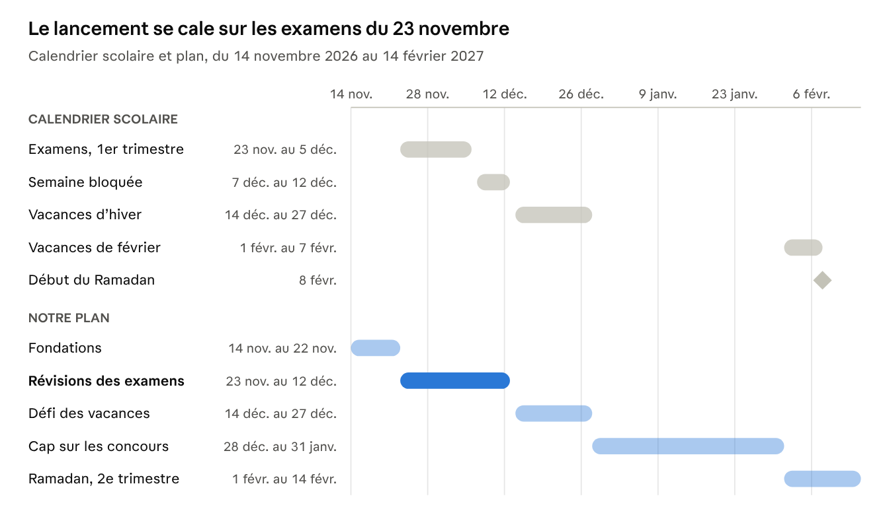

# Na9ra Nal3ab — Stratégie d'acquisition et plan d'action Facebook / Instagram

14 novembre 2026

## L'essentiel

La plateforme est prête, mais peu visitée et mal abordée : 6 718 exercices en ligne, environ 850 visiteurs par mois arrivés surtout sur la page d'accueil, jamais plus de 6 comptes actifs par semaine. Le plan tient en une phrase : faire du test de niveau l'unique appel à l'action, parler aux parents de 6ᵉ et de 9ᵉ sur Facebook et aux élèves sur Instagram, et démarrer le 23 novembre, premier jour des examens du trimestre.

Objectif au 14 février, scénario central : 500 apprenants actifs par semaine, 10 000 visites tracées, 2 000 tests terminés.

_Le parcours visé : tout mène au test de niveau, et le test ramène de nouveaux visiteurs._

Chaque bilan ouvre deux suites : envoyer le lien du même test à un ami, ou garder son bilan dans un compte gratuit.

### Les cinq choix du plan

1. **Une tête de pont** : les familles de 6ᵉ et de 9ᵉ qui préparent un concours, là où le contenu est le plus profond.
2. **Un seul appel à l'action** : le test de niveau, 10 questions, une note sur 20, sans compte.
3. **Une position** : « ici on s'entraîne ». Le gratuit ne suffit plus, deux offres gratuites occupent déjà le terrain.
4. **Les groupes à visage découvert**, par toi, un quart d'heure par jour. Pas d'adhésions ni de commentaires à la machine : c'est le profil qui administre ta Page qui serait sanctionné.
5. **Tout se mesure** : chaque lien est tracé, une revue chaque lundi.

### Ce qui t'attend, par ordre d'urgence

| Geste ou décision | Pourquoi | Quand |
| --- | --- | --- |
| Brancher Metricool et le connecteur PostHog | Sans eux, je ne peux ni publier ni lire le trafic | Avant le 20 novembre |
| Ajouter un second administrateur à la Page | Ton profil est aujourd'hui le seul point d'accès | Cette semaine |
| Relire l'arabe des seize publications et des visuels | C'est ton oreille qui décide du mot juste | Avant la programmation |
| Ouvrir un lien depuis l'application Facebook sur ton téléphone, faire le test, créer un compte avec Google | C'est le chemin réel de tes futurs visiteurs, et je ne peux pas l'essayer d'ici | Avant le 23 novembre |
| Déposer la déclaration INPDP et compléter les mentions légales | Préalable à la publicité payante et aux écoles (section 11) | Avant la mi-décembre |
| Arbitrer deux chantiers produit | Un aperçu de deux questions sur les missions verrouillées, déjà recommandé par l'audit du 12 novembre ; un calculateur de moyenne pour les bulletins de décembre. La langue d'arrivée peut attendre : 2 % des téléphones sont en arabe | Cette semaine |
| Revoir la priorité de contenu du Bac | La section Économie-gestion pèse 35 % des candidats et n'a que 15 exercices de gestion | Quand tu veux |
| Écrire en trois phrases pourquoi tu as créé la plateforme | C'est l'accroche de ta présentation et du communiqué | Cette semaine |

Deux gestes de cinq minutes s'y ajoutent : répondre aux six commentaires qui attendent sur la Page, et remplacer sa présentation, dont la promesse n'est pas prouvable (section 11).

## 1. Diagnostic — le produit est prêt, le public n'existe pas encore

Le site reçoit environ 850 visiteurs par mois, dont 560 de Tunisie et la moitié par Facebook. Mais ils restent 51 secondes en moyenne et presque aucun ne joue avec un compte : jamais plus de 6 comptes actifs la même semaine depuis juin. Le problème est double : trop peu de visiteurs, et des visiteurs envoyés au mauvais endroit.

_Inscriptions et comptes actifs par semaine, du 1er juin au 14 novembre 2026 (base de production, dernière semaine en cours)._

La semaine du 19 octobre compte 11 inscriptions pour 2 comptes actifs : s'inscrire ne suffit pas à jouer.

Sur 60 élèves inscrits, 24 ont terminé au moins une mission et 8 sont revenus un autre jour. Les 30 derniers jours comptent 8 comptes actifs et 44 missions terminées.

_Les 60 comptes élève créés de mai au 14 novembre 2026, palier par palier (base de production)._

À ce volume, ces taux sont indicatifs. Ils deviendront lisibles avec les premiers milliers de visiteurs.

### Ce que le relevé du 14 novembre ajoute

La session locale a lu Google Analytics, Search Console et Meta Business Suite ; son détail est en [annexe D](#m46485ysh2k.34010).

| Constat | Chiffre | Ce qu'on en tire |
| --- | --- | --- |
| Trafic sur 28 jours | 851 utilisateurs, 973 sessions ; Tunisie 66 % ; téléphone 78 % | Le téléphone d'abord, toujours |
| D'où ils viennent | Facebook 493 sessions, accès direct 420, Google 45 | Facebook amène déjà du monde ; Google n'a pas commencé |
| Où ils arrivent | Page d'accueil 570 sessions ; test de niveau 9 | Le test n'a jamais été mis en avant : c'est le premier gain |
| Ce qui a fait cliquer | Un texte avec un lien, publié une fois le 23 septembre : 47 clics. Onze publications identiques en cinq minutes le 18 octobre : 4 clics | Une publication utile bat une rafale |
| Google | 1 page indexée ; 3 346 pages découvertes depuis le plan du site du 12 novembre | À revérifier dans deux semaines |
| Page Facebook | 155 abonnés, dont 52 % de 35-44 ans ; 6 commentaires sans réponse depuis 11 à 18 semaines | L'audience est bien celle des parents ; répondre d'abord à ceux qui ont écrit |
| Instagram | 12 abonnés, aucune publication depuis le 22 août | Tout est à faire |
| Langue des téléphones | Français 69 %, arabe 2 % | L'accueil en français n'est pas le frein qu'on pouvait craindre |

### Ce que la plateforme a déjà pour elle

| Atout | Preuve (base de production, 14 novembre 2026) |
| --- | --- |
| Gratuite et jouable sans compte | Aucun mur de connexion sur les pages publiques |
| Classes de concours complètes | 6ᵉ : 5 matières, 72 chapitres, 562 exercices. 9ᵉ : 6 matières, 98 chapitres, 970 exercices, sujets nationaux repris et corrigés |
| Bac ouvert sur six sections | De 100 exercices (Lettres) à 306 (Mathématiques) |
| Un test de niveau public | 10 questions, note sur 20, bilan par chapitre, partage en un geste |
| Le partage est déjà dans le produit | « Partager ma réussite », « Inviter mon parent », lien WhatsApp, image d'aperçu des liens |
| Bientôt trouvable sur Google | Plan du site complet lu par Google le 14 novembre ; une seule page indexée pour l'instant |
| Trois langues | Français, arabe, anglais |

### Ce qui freine

- **Aucun canal d'acquisition n'est ouvert.** C'est l'indicateur n° 1 du tableau de bord du projet, à zéro depuis juin.
- **L'inscription n'active pas.** 36 élèves inscrits sur 60 n'ont jamais terminé une mission ; 16 n'ont même pas choisi leur classe.
- **Le test de niveau n'a pas encore de public.** 4 tests démarrés depuis le 1ᵉʳ novembre, 2 terminés.
- **Les parents ne sont pas reliés.** 17 comptes parent, 2 liens parent-enfant, aucun abonnement aux notifications.
- **L'accueil est en français.** Mesuré le 14 novembre : 69 % des téléphones sont réglés en français et 2 % en arabe. Ce n'est pas le frein qu'on pouvait craindre.
- **Certains niveaux sont trop minces pour être mis en avant.** La 3ᵉ secondaire n'a qu'une matière et 36 exercices par section.
- **Deux verrous hors code** pèsent sur la publicité et les partenariats : la déclaration INPDP et l'identité de l'éditeur dans les mentions légales (section Garde-fous).

Conséquence : aujourd'hui, une heure passée à faire connaître la plateforme rapporte plus qu'une heure de produit. L'objectif des 90 jours : envoyer les visiteurs au test plutôt qu'à l'accueil, en amener quatre fois plus, puis lire ce qu'ils font.

## 2. Marché et calendrier

La Tunisie compte 2,34 millions d'élèves, dont environ 550 000 en année d'examen national. Les examens du premier trimestre commencent le 23 novembre : la fenêtre s'ouvre dans neuf jours.

### La taille du marché

| Population | Effectif | Source |
| --- | --- | --- |
| Élèves du primaire au lycée, 2026-2027 | 2,341 millions, dont 1,195 au primaire et 1,146 au collège et au lycée | [Business News, 15 septembre 2026](https://businessnews.com.tn/2026/09/15/la-rentree-scolaire-en-chiffres/1418442/) |
| Enseignants | 161 300 | même source |
| Élèves de 6ᵉ, 2025-2026 | 213 508 | [Orientini](https://www.orientini.com/FR/Annonces_Orientation_Formation_Emploi/17289/) |
| Inscrits au concours de 6ᵉ 2026 | 62 450, soit 29 % de la classe d'âge ; 5 317 admis en collège pilote | [Tunisie Numérique](https://www.tunisienumerique.com/concours-de-la-sixieme-2026-le-ministere-de-leducation-annonce-les-resultats/) |
| Élèves de 9ᵉ, 2025-2026 | 175 024 | [La Presse, 18 juin 2026](https://lapresse.tn/2026/06/18/taux-record-dabstention-seulement-18-des-eleves-de-base-passent-le-concours-du-neuvieme/) |
| Inscrits au concours de 9ᵉ 2026 | 32 004, soit 18 % ; 6 063 orientés en lycée pilote | [Webdo](https://www.webdo.tn/fr/actualite/national/neuvieme-2026-6396-taux-de-reussite-tasnim-cherif-major-nationale/400524/) |
| Inscrits au Bac 2026 | 162 435 ; 50,72 % d'admis après les deux sessions | [AllAfrica, 12 juillet 2026](https://fr.allafrica.com/stories/202607120087.html) |

Deux lectures. La tête de pont « concours » représente environ 95 000 familles très motivées par an. Et au Bac, la section Économie-gestion pèse 35 % des inscrits pour 26 % de réussite à la session principale : c'est la plus grande et la plus en difficulté, alors que c'est l'une de nos moins fournies (15 exercices de gestion).

### Ce que les familles dépensent déjà

Deux familles sur trois paient des cours particuliers, selon une [étude du FTDES de 2023](https://www.leconomistemaghrebin.com/2023/09/13/tunisie-cout-rentree-scolaire-enregistre-hausse-de-48/) menée à Monastir. Le prix courant est de [80 à 90 dinars par matière et par mois](https://www.tuniscope.com/ar/article/431345/arabe/actu-arabe/tunisie-023412), davantage en période de révision. Un entraînement gratuit et corrigé répond à une dépense que la plupart des parents subissent.

### Où sont les parents, où sont les élèves

| Réseau | Audience en Tunisie, fin 2026 | Qui |
| --- | --- | --- |
| Facebook | 7,40 millions | Les 25-54 ans font les deux tiers de l'audience : c'est le réseau des parents |
| Instagram | 4,15 millions | 100 % des moins de 18 ans interrogés l'utilisent chaque jour |
| TikTok | 7,11 millions d'adultes | 94 % des moins de 18 ans chaque jour |
| YouTube | 7,77 millions | 71 % des moins de 18 ans chaque jour |

Audiences : [DataReportal, Digital 2027 Tunisia](https://datareportal.com/reports/digital-2027-tunisia). Usages par âge : [NapoleonCat](https://napoleoncat.com/stats/social-media-users-in-tunisia/) et l'enquête Medianet 2025 relayée par [Mosaïque FM](https://www.mosaiquefm.net/mobile/ar/أخبار-تكنولوجيا-تونس-العالم/1408222/تحو-ل-رقمي-يقوده-الشباب-تيك-توك-وأنستغرام-الأكثر-شعبية-في-تونس), dont la méthode n'est pas publiée. Selon cette enquête, 65 % des moins de 18 ans disent ne jamais utiliser Facebook. Ton choix de Facebook pour les parents et d'Instagram pour les élèves est le bon ; TikTok devra suivre vite.

### La concurrence

| Acteur | Ce qu'il offre | Prix | Audience relevée | Ce que cela nous dit |
| --- | --- | --- | --- | --- |
| [Taki Academy](https://www.takiacademy.com) | Cours vidéo, directs, exercices ; de la 4ᵉ primaire au Bac | Abonnements, tarifs non publiés | 435 000 élèves inscrits revendiqués ; environ 596 000 abonnés Facebook, 571 000 sur YouTube | Le leader vend du cours à regarder. Notre terrain est l'entraînement |
| [Class Quiz](https://classquiz.tn) | Exercices ludiques, primaire 1 à 6 | 100 à 120 DT par an selon ses publications | 300 000 abonnés revendiqués ; 223 000 sur Facebook | Les parents du primaire paient pour de l'exercice ludique |
| [Scolaire.tn](https://scolaire.tn) | 6ᵉ et 9ᵉ seulement : leçons, 2 792 exercices, annales, concours blancs | Exercices gratuits ; suivi parent à 55 DT par an | Non publiée | Le plus proche de notre tête de pont |
| [Joussour](https://managers.tn/2026/03/30/une-premiere-nationale-la-tunisie-lance-sa-plateforme-officielle-de-soutien-scolaire-gratuite-du-primaire-jusquau-baccalaureat/), ministère de l'Éducation | Soutien gratuit : séances en direct avec des inspecteurs, enregistrements, exercices | Gratuit | Environ 130 000 élèves à la première édition | « Gratuit » et « officiel » sont déjà pris |
| Sites de devoirs : [devoir.tn](https://www.devoir.tn), [tunisiecollege.net](https://www.tunisiecollege.net), [9raya.tn](https://www.9raya.tn) | Devoirs et corrigés à télécharger | Gratuits | 100 000 à 300 000 visites par mois chacun, selon Similarweb | La demande de « devoir avec correction » est massive |
| [Tadris.tn](https://www.tadris.tn/tadris-ou-taki-academy.html), [Tunisia Study](https://tunisia-study.com/) | Cours en direct | 17 à 180 DT par mois | Non publiée | Le direct est cher ; l'exercice corrigé ne coûte rien à servir |

Conséquence pour le message : « gratuit » ne suffit plus à nous distinguer. Notre place est l'entraînement immédiat : on ouvre un lien, on répond, on est corrigé, sans compte, de la 1ʳᵉ année au Bac, avec un test de niveau et un suivi parent sans frais.

### Ce que les parents tapent dans Google

La requête type est « type de document + matière + année + trimestre + مع الإصلاح ». La première requête relevée est « احتساب المعدل », le calcul de la moyenne, avec environ 6 000 recherches par mois selon [Ahrefs](https://ahrefs.com/websites/devoir.tn). Deux suites : aligner les titres de nos pages sur ces mots, et offrir un calculateur de moyenne au moment des bulletins.

### Le calendrier 2026-2027

Les dates viennent des annonces du ministère relayées par [Business News](https://businessnews.com.tn/2026/09/24/publication-du-calendrier-officiel-des-examens-pour-lannee-scolaire-2026-2027/1419874/) et [Webdo](https://www.webdo.tn/fr/actualite/national/examens-nationaux-2027-le-ministere-de-leducation-fixe-les-dates-du-bac-et-des-concours/404883/). Elles sont dessinées avec le plan dans la section 12.

## 3. Cibles et tête de pont

La tête de pont est la famille d'un élève de 6ᵉ ou de 9ᵉ qui prépare son concours : c'est là que le contenu est le plus profond et l'enjeu le plus fort. Le Bac vient en second, par Instagram.

| Cible | Qui décide, qui joue | Où les trouver | Ce qu'on leur offre aujourd'hui | Priorité |
| --- | --- | --- | --- | --- |
| Parents d'élèves de 6ᵉ (concours d'entrée aux collèges pilotes) | Le parent décide ; l'enfant de 11-12 ans joue, souvent sur le téléphone du parent | Groupes Facebook de parents, groupes Messenger et WhatsApp de classe | Test de niveau, 562 exercices sur 5 matières, sujets du concours corrigés, suivi parent | 1 |
| Élèves de 9ᵉ et leurs parents (concours de fin de base, lycées pilotes) | L'élève de 14-15 ans joue seul ; le parent pousse | Facebook pour les parents, Instagram pour les élèves | 970 exercices sur 6 matières, sujets nationaux corrigés, test de niveau, duels | 1 |
| Candidats au Bac | L'élève, seul | Instagram, groupes Facebook par section | 6 sections ouvertes ; maths, physique, technologie, informatique et philosophie sont les plus fournies | 2 |
| Enseignants et professeurs de cours particuliers | Prescripteurs : un enseignant touche 25 à 35 familles | Groupes Facebook d'enseignants | Cours conformes et imprimables, un lien par chapitre à envoyer au groupe de la classe | 2 |
| Parents des autres niveaux (1ʳᵉ à 8ᵉ) | Le parent | Recherche Google, bouche-à-oreille | 195 à 437 exercices par niveau | 3 |

Trois raisons de commencer par les concours :

1. **La profondeur.** La 9ᵉ et la 6ᵉ sont les deux niveaux les plus complets du catalogue. On ne promet que ce qui existe.
2. **L'enjeu et le calendrier.** Ces familles révisent dès maintenant pour une échéance datée, en juin 2027. Elles reviennent chaque semaine si l'outil les aide.
3. **La concentration.** Elles se regroupent dans des communautés identifiables, où une recommandation circule vite.

Ce qu'on ne vise pas maintenant : la 2ᵉ et la 3ᵉ secondaire (contenu encore mince), les établissements (après la déclaration INPDP et les mentions légales complètes), la diaspora.

Règle de conduite : sur Facebook on parle aux parents ; sur Instagram on parle aux élèves par des contenus publics, jamais par message privé.

## 4. Positionnement et messages

La promesse tient en une ligne : **« Chez les autres on regarde, ici on s'entraîne »** — tout le programme tunisien en exercices corrigés, gratuit et sans inscription. C'est la position de référence déjà arrêtée par le projet ; on la garde, on la traduit en mots de parents.

| Langue | Signature |
| --- | --- |
| Français | Révise en jouant : tout le programme tunisien en exercices corrigés, gratuit et sans inscription. |
| Arabe | راجع وأنت تلعب: تمارين مع الإصلاح في كامل البرنامج التونسي، مجانًا ودون تسجيل. |

### Les cinq preuves, toutes vérifiables sur le site

1. **Gratuit, sans inscription.** On ouvre le lien, on joue.
2. **Conforme au programme officiel.** Écrit à partir des manuels scolaires tunisiens, niveau par niveau.
3. **On s'entraîne vraiment.** 6 700 exercices, 40 000 questions, chaque réponse corrigée et expliquée.
4. **Les sujets des concours.** Les épreuves nationales de 6ᵉ et de 9ᵉ, reprises et corrigées.
5. **Le parent voit les progrès.** Un suivi jour par jour, sans rien installer.

### Un message par cible

| Cible | Sa question | Notre réponse | Version arabe | Appel à l'action |
| --- | --- | --- | --- | --- |
| Parents de 6ᵉ | « Mon enfant est-il prêt pour le concours ? » | En 7 minutes, sachez où il en est en maths : 10 questions, une note sur 20, les chapitres à revoir. | في 7 دقائق، اعرف مستوى ابنك في الرياضيات: 10 أسئلة، عدد على 20، والدروس التي تحتاج إلى مراجعة. | Faire le test avec lui |
| Élèves de 9ᵉ | « Je révise, mais je vaux combien ? » | Ta note sur 20 en 10 questions. Et tes amis, ils ont combien ? | 10 أسئلة وتعرف عددك على 20. وأصحابك، قدّاش جابو؟ | Passer le test, défier un ami |
| Candidats au Bac | « Trop de vidéos, pas assez d'entraînement » | Arrête de regarder, entraîne-toi : des exercices par chapitre, corrigés tout de suite. | كفى مشاهدة، حان وقت التمرين: تمارين لكل درس، مع الإصلاح في الحين. | Ouvrir sa section |
| Enseignants | « Je manque d'exercices prêts » | Un quiz par chapitre, conforme au manuel, à envoyer à votre classe en un lien. | اختبار قصير لكل درس، مطابق للكتاب المدرسي، ترسله إلى قسمك برابط واحد. | Parcourir les cours |

### Les mots

- **À employer** : gratuit, sans inscription, exercices corrigés (تمارين مع الإصلاح), programme officiel, concours, test de niveau, note sur 20.
- **À ne jamais écrire** : premium, abonnement, payant (règle du projet) ; « officiel » ou « ministère » pour parler de nous ; « réussite garantie » ; un nombre d'utilisateurs ; un témoignage qui n'existe pas ; le nom d'un concurrent.
- **Le ton** : un grand frère qui a réussi. Direct, chaleureux, jamais professoral. Sobre et rassurant avec les parents, joueur avec les élèves.
- **Les langues** : arabe simple sur Facebook pour les parents, avec les termes scolaires français d'usage ; mélange derja et français sur Instagram pour les élèves. Toujours signer dans les deux écritures : Na9ra Nal3ab · نقرا نلعب.

Les textes arabes de ce document sont à relire par toi avant publication : j'écris en arabe standard simple, plus sûr que le dialecte écrit, et c'est ton oreille qui décide du mot juste.

## 5. L'offre d'appel : le test de niveau

Pendant 90 jours, toutes les publications mènent au même geste : **faire le test de niveau** — 10 questions, 7 minutes, une note sur 20, sans compte.

Quatre raisons de tout miser sur lui :

1. **Il donne avant de demander.** Le visiteur reçoit quelque chose dès la première minute, sans inscription.
2. **Il produit un chiffre qu'on compare.** L'écran de bilan dit déjà « Et tes amis, ils ont combien ? » et partage le lien en un geste.
3. **Il mène au bon endroit.** Le bilan nomme les chapitres à revoir et ouvre le premier cours.
4. **Il se mesure de bout en bout** : commencé, terminé, partagé, rattaché à un compte.

Premier palier à franchir : 20 tests terminés par matière phare. C'est le seuil à partir duquel le bilan affiche « mieux que X % des élèves », ce qui donne envie de partager.

### Les liens directs

Chaque lien s'ouvre sur le bouton « Commencer le test » de la bonne matière. Vérifiés en production le 14 novembre 2026.

| Public | Matière | Lien |
| --- | --- | --- |
| 6ᵉ | Mathématiques | https://www.na9ranal3ab.tn/test-de-niveau?matiere=math-6eme |
| 6ᵉ | Éveil scientifique | https://www.na9ranal3ab.tn/test-de-niveau?matiere=eveil-scientifique-6eme |
| 9ᵉ | Mathématiques | https://www.na9ranal3ab.tn/test-de-niveau?matiere=math |
| 9ᵉ | Sciences de la vie et de la Terre | https://www.na9ranal3ab.tn/test-de-niveau?matiere=sciences-vie-terre |
| 9ᵉ | Sciences physiques | https://www.na9ranal3ab.tn/test-de-niveau?matiere=svt |
| Bac Mathématiques | Mathématiques | https://www.na9ranal3ab.tn/test-de-niveau?matiere=math-bac-math |
| Bac Sciences techniques | Technologie | https://www.na9ranal3ab.tn/test-de-niveau?matiere=technologie-bac-techniques |
| Bac Sciences de l'informatique | Informatique | https://www.na9ranal3ab.tn/test-de-niveau?matiere=informatique-bac-info |
| Tous | Au choix | https://www.na9ranal3ab.tn/test-de-niveau |

Pour les parents, le test propose le mode « Je suis parent » : le parent passe le test lui-même, sur le programme de son enfant, hors classement.

### Les rendez-vous de la semaine

Quatre rendez-vous fixes, pour que l'audience sache quand revenir.

| Jour | Rendez-vous | Format | Pour qui |
| --- | --- | --- | --- |
| Lundi | La question du lundi | Une question de concours en image ; la réponse expliquée le soir en commentaire, avec le lien du chapitre | Parents et élèves de 6ᵉ et 9ᵉ |
| Mercredi | Le sujet corrigé | Un exercice tiré d'un sujet national, corrigé pas à pas en carrousel | 9ᵉ et Bac |
| Vendredi | Le défi du week-end | Le test de niveau d'une matière ; « partage ta note » | Tous |
| Dimanche soir | Le plan de la semaine | Trois chapitres à réviser cette semaine et un conseil de suivi | Parents |

## 6. Canaux : un rôle par canal

Facebook amène les parents, Instagram les élèves, WhatsApp fait circuler entre familles, Google capte ceux qui cherchent déjà. La Page est la vitrine ; les groupes et les partenaires font la portée.

| Canal | Son rôle | Ce qu'on y fait | Qui | Démarrage |
| --- | --- | --- | --- | --- |
| Page Facebook | Vitrine et rendez-vous de la semaine, pour les parents | 4 publications par semaine, réponse du soir en commentaire | Claude programme, tu réponds | Semaine 1 |
| Groupes Facebook | La portée : les parents y sont déjà | Réponses utiles signées de ton nom, accords avec les administrateurs | Toi, 15 minutes par jour, avec mes textes | Semaine 1 pour les administrateurs, semaine 2 pour les réponses |
| Instagram | Les élèves de 9ᵉ et du Bac | 3 publications par semaine, une story par jour d'école | Claude programme | Semaine 1 |
| WhatsApp | La circulation entre familles et entre classes | Une chaîne pour le défi du vendredi ; les liens par chapitre que les enseignants envoient à leur classe | Tu crées la chaîne, j'écris | Semaine 2 |
| Recherche Google | La demande qui existe déjà, tous niveaux | Rien à publier : suivre l'indexation des 6 815 pages, ajuster les titres aux mots des parents | Claude, côté produit | En continu |
| Enseignants et professeurs particuliers | La prescription | Un kit d'une page, un message par semaine dans leurs groupes | Toi et Claude | Semaine 3 |
| Médias et partenaires | La crédibilité | Un communiqué à un moment fort, d'abord le défi des vacances d'hiver | Toi, texte par Claude | Semaine 6 |
| Publicité Meta | Un accélérateur, pas un moteur | Amplifier seulement les publications qui ont déjà prouvé leur taux de clic, vers des adultes | Toi (paiement), réglages par Claude | Après 3 semaines de données |
| TikTok, YouTube Shorts | Extension | Reprendre les vidéos courtes : 94 % des moins de 18 ans y sont chaque jour | Claude | Dès la semaine 7, pendant la phase concours |

Deux règles tiennent tout le dispositif :

- **Tout lien est tracé** (section Mesure), pour savoir quel canal amène des élèves qui jouent, pas seulement des clics.
- **Aucun traceur publicitaire n'est posé sur le site.** Le public est fait d'enfants, le site n'a pas de bandeau de consentement et la déclaration INPDP n'est pas déposée. La publicité se mesure par ses liens, pas par un pixel.

## 7. Ligne éditoriale Facebook et Instagram

Quatre publications par semaine sur Facebook, trois sur Instagram, une story par jour d'école. Chaque publication apprend quelque chose en dix secondes et mène au test ou à un chapitre.

### Les quatre piliers

| Pilier | Part | Exemples | Ce qu'il produit |
| --- | --- | --- | --- |
| On s'entraîne | 50 % | La question du lundi, le sujet corrigé | La preuve de la valeur, des commentaires |
| On se mesure | 25 % | Le défi du week-end, le test de niveau | Des visites sur le site |
| On accompagne les parents | 15 % | Le plan de la semaine, un conseil de suivi | Des parents qui reviennent |
| On montre la plateforme | 10 % | Un nouveau chapitre en ligne, le kit enseignant | De la confiance |

### Les formats

| Format | Usage | Taille |
| --- | --- | --- |
| Image seule | Question du lundi, défi, plan de la semaine | 1080 × 1350 |
| Carrousel de 3 à 5 images | Sujet corrigé : énoncé, solution, erreur fréquente | 1080 × 1350 |
| Story | Sondage ou quiz du jour, avec le lien du test | 1080 × 1920 |
| Vidéo courte de 20 à 30 secondes | Une erreur fréquente expliquée à l'écran | 1080 × 1920, à partir de la semaine 5 |
| Texte long | Le plan de la semaine, sur Facebook seulement | sans image ou avec le visuel « plan » |

Dix-huit visuels sont déjà produits aux polices et couleurs du site. Ils sont rangés dans l'ordre du calendrier sur une page privée, avec leur gabarit : [Visuels sociaux Na9ra Nal3ab](https://claude.ai/artifact/SprQCgonq1SAa84sw54UCA).

### Les règles d'écriture

1. Une seule idée par publication. La première ligne est la question ou le bénéfice.
2. Le lien mène à la bonne matière, jamais à la page d'accueil.
3. « Gratuit, sans inscription » figure sur chaque visuel.
4. La réponse à une question arrive le soir même, en commentaire, avec l'explication et le lien du chapitre.
5. Arabe d'abord sur Facebook ; mélange derja et français sur Instagram.
6. Aucun chiffre d'audience, aucun témoignage, aucune promesse de résultat.

### Les horaires de départ

Publication à 19 h en semaine et à 18 h le vendredi, plan de la semaine le dimanche à 20 h. C'est une hypothèse : les rares sessions enregistrées sur la plateforme se concentrent entre 19 h et 22 h. On recale après deux semaines de statistiques réelles.

### Les deux vitrines à régler une fois

| Élément | Page Facebook | Instagram |
| --- | --- | --- |
| Nom | Na9ra Nal3ab · نقرا نلعب | même nom, compte professionnel relié à la Page |
| Présentation | تمارين مع الإصلاح في كامل البرنامج التونسي، من السنة الأولى إلى الباكالوريا. مجانًا ودون تسجيل. | Tout le programme tunisien en exercices corrigés. Gratuit, sans inscription. |
| Bouton ou lien | « En savoir plus » vers le test de niveau | Lien de la bio vers le test de niveau |
| Repères | Publication épinglée : les cinq preuves | À la une : Test, 6ᵉ, 9ᵉ, Bac, Parents |

Les deux comptes existent déjà : la Page [Na9ra Nal3ab](https://www.facebook.com/na9ranal3ab), 155 abonnés, et le compte Instagram @na9ranal3ab, 12 abonnés, professionnel et relié à la Page. Il s'agit de les régler, pas de les créer.

### La tenue des commentaires

- Réponse sous 24 heures, signée, sans jargon.
- Une critique reçoit un merci et une correction, jamais une dispute.
- On ne demande jamais d'information personnelle à un élève, et on n'écrit pas en privé à un mineur au-delà de la réponse à sa propre question.
- Une erreur signalée dans un exercice part dans le circuit de signalement du site ; on remercie publiquement.

## 8. Groupes de parents et d'élèves

Les groupes sont le canal le plus puissant, et le seul où je ne te remplace pas : c'est toi qui y parles, à visage découvert, un quart d'heure par jour, avec mes textes. Rejoindre et commenter partout à la machine ferait restreindre ton profil, et ton profil est l'administrateur de ta Page.

### Pourquoi pas en automatique

1. **Les règles.** Les [conditions d'utilisation de Facebook](https://www.facebook.com/terms) interdisent d'accéder au service par des moyens automatisés sans autorisation, et ses [standards sur le spam](https://transparency.meta.com/policies/community-standards/spam/) visent les publications répétées à haute fréquence. Meta n'offre plus d'interface officielle pour publier dans les groupes.
2. **Le risque.** Un profil qui rejoint des dizaines de groupes et y colle le même message est ce que les filtres cherchent. La sanction va du blocage des commentaires à la désactivation du compte. Ton profil administre la Page : le perdre, c'est perdre la Page, l'Instagram relié et le compte publicitaire.
3. **L'efficacité.** Dans un groupe de parents, une publicité copiée-collée est supprimée et laisse une mauvaise trace. La réponse utile d'un fondateur qui se présente est remerciée et partagée.

À faire cette semaine, quel que soit le reste : ajouter un second administrateur de confiance à la Page.

### La méthode en cinq gestes

1. **Choisir 15 à 20 groupes**, en trois familles : parents de 6ᵉ, parents et élèves de 9ᵉ, enseignants. Lire les règles de chacun.
2. **Écrire d'abord à l'administrateur** (annexe B). Là où la publicité est interdite, rien ne se publie sans son accord.
3. **Se présenter une fois**, sous ton nom : fondateur de Na9ra Nal3ab, plateforme tunisienne gratuite.
4. **Répondre aux questions des parents.** Quand quelqu'un cherche des exercices ou un devoir corrigé, donner le lien du chapitre exact et une phrase d'aide. Trois à cinq réponses par jour au total, jamais deux fois le même texte.
5. **Tenir un seul rendez-vous par groupe partenaire** : le quiz de la semaine, rien d'autre.

### Ce qu'on ne fera pas

- Rejoindre en masse, publier le même message dans plusieurs groupes, commenter sous des publications sans rapport.
- Se faire passer pour un parent ou un élève satisfait, créer de faux comptes.
- Écrire en privé à des mineurs.
- Automatiser quoi que ce soit sur ton profil personnel.

### Ce que je fais pour toi

- La liste classée des groupes : taille, public, règles sur la publicité.
- Les messages aux administrateurs, ta présentation, et des réponses prêtes par situation, avec le lien du bon chapitre.
- Un lien tracé par groupe, pour savoir lequel amène des élèves qui jouent.
- Chaque lundi, les sujets qui reviennent dans les questions des parents, pour en faire le contenu de la semaine.

La session locale lancée sur ton ordinateur peut repérer les questions et préparer les réponses. C'est toi qui cliques sur Publier.

## 9. Partenariats

Un administrateur de groupe ou un enseignant convaincu vaut cent publications. L'objectif à 90 jours est de 5 administrateurs partenaires et 30 enseignants relais.

| Partenaire | Ce qu'on lui apporte | Ce qu'on lui demande | Premier pas |
| --- | --- | --- | --- |
| Administrateurs de groupes et de grandes pages de parents ou d'élèves | Un quiz de la semaine prêt à publier pour leurs membres, des réponses aux questions de révision, aucune publicité hors de l'accord | Une publication par semaine, si possible épinglée | Le message de l'annexe B, 10 contacts la première semaine |
| Enseignants et professeurs de cours particuliers | Un quiz par chapitre conforme au manuel, des cours imprimables, leurs demandes de chapitres traitées en premier | Envoyer un lien à leur classe, nous dire ce qui manque | Le kit d'une page, un message par semaine dans leurs pages |
| Associations de parents et d'éducation | Un outil gratuit à recommander, cohérent avec leur discours sur le coût des cours particuliers | Un relais auprès de leurs adhérents | Un courrier pendant les vacances d'hiver |
| Médias : radios, sites d'actualité, rubriques consacrées aux jeunes entreprises | Une histoire tunisienne et des chiffres vérifiables : 40 000 questions, gratuit, de la 1ʳᵉ année au Bac | Un passage ou un article | Un communiqué pour le défi des vacances |
| Écoles privées | Un outil de révision sans coût ni installation | Un essai dans deux écoles | Après la déclaration INPDP et les mentions légales complètes |
| Fondations d'entreprise actives dans l'école numérique | Un contenu conforme au programme, prêt à l'emploi | Une discussion | Plus tard : il faut une structure identifiée en face |

Deux garde-fous :

- **On ne promet que ce qui existe.** L'espace enseignant avec classes et codes n'est pas construit. Le kit parle de liens par chapitre et de cours imprimables, rien de plus.
- **Aucune contrepartie cachée.** Pas de rémunération contre une recommandation présentée comme spontanée. Un partenariat se dit.

Les grandes pages publiques relevées, avec leur audience, sont en annexe C. Les groupes Facebook ne se voient pas depuis le web ouvert : c'est le relevé de la session locale qui en donnera la liste.

Une question pour toi : pourquoi as-tu créé cette plateforme ? Trois phrases de ta main suffisent. C'est le meilleur angle pour les médias et pour ton premier message dans les groupes ; je rédige le reste.

## 10. Mesure

Un seul chiffre commande : les apprenants actifs par semaine, c'est-à-dire toute personne qui répond à au moins une question, avec ou sans compte. Il vaut entre 0 et 6 aujourd'hui ; la cible est 500 au 14 février.

| Indicateur | Aujourd'hui | Au 12 décembre | Au 14 février |
| --- | --- | --- | --- |
| Apprenants actifs par semaine | 0 à 6 comptes | 100 | 500 |
| Visites arrivées par nos liens tracés, en cumul | non mesuré | 2 000 | 10 000 |
| Tests de niveau terminés, en cumul | 2 | 400 | 2 000 |
| Comptes créés depuis le lancement | 0 | 80 | 500 |
| Élèves inscrits qui terminent une mission | 40 % | 50 % | 60 % |
| Retour la semaine suivante | 0 sur 3 | lisible | 20 % |
| Administrateurs de groupe partenaires | 0 | 2 | 5 |
| Enseignants relais | 0 | 5 | 30 |

Ces cibles sont celles du scénario central de la section 13. Ce sont des hypothèses de travail, à recaler après deux semaines de données réelles.

### Tout lien est tracé

Chaque lien publié porte quatre étiquettes. Google Analytics les lit nativement et PostHog garde l'adresse complète de chaque page vue. Vérifié en production : elles ne gênent pas le site.

| Étiquette | Valeurs |
| --- | --- |
| `utm_source` | facebook, instagram, whatsapp, tiktok |
| `utm_medium` | page, groupe, story, bio, partenaire, enseignant, pub |
| `utm_campaign` | le thème : examens-t1, defi-vacances, concours, ramadan |
| `utm_content` | le repère de la publication ou du groupe : q-lundi-6e, g01 |

Exemple, pour la publication du test de maths de 6ᵉ sur la Page :

`https://www.na9ranal3ab.tn/test-de-niveau?matiere=math-6eme&utm_source=facebook&utm_medium=page&utm_campaign=examens-t1&utm_content=test-6e`

### Où se lit chaque réponse

| Question | Source | Qui la lit |
| --- | --- | --- |
| Combien d'apprenants actifs, de comptes, de tests ? | Base de production | Claude, dès maintenant |
| D'où viennent les visiteurs, que font-ils sans compte ? | PostHog et Google Analytics | Claude par le connecteur PostHog ; d'ici là, la session locale |
| Quelles publications marchent ? | Statistiques Meta | Claude par Metricool ; d'ici là, la session locale |
| Sommes-nous trouvés sur Google ? | Search Console | La session locale |

### La revue du lundi

Trente minutes, quatre points : le relevé d'engagement automatique du lundi, les visites par source, les trois meilleures et les trois moins bonnes publications, puis une décision écrite : ce qu'on double, ce qu'on arrête. Dès que les deux connecteurs sont branchés, je produis cette revue seul et je l'écris en tête de ce document.

## 11. Garde-fous

Quatre risques peuvent coûter plus cher que ce que la campagne rapporte : la loi sur les données des enfants, les règles de Meta, la publicité trompeuse et le contact avec des mineurs. Aucun n'empêche de démarrer le 23 novembre, à condition de pousser le parcours sans compte. Ce qui suit n'est pas un avis juridique : un avocat ou l'INPDP doit confirmer.

### Les données personnelles : le point le plus sérieux

La [loi organique n° 2004-63](https://www.ins.tn/sites/default/files/2020-04/Loi%2063-2004%20Fr.pdf) est toujours en vigueur ; une réforme est en commission au Parlement.

| Ce que dit la loi | Où en est la plateforme | Ce que cela change pour la campagne |
| --- | --- | --- |
| Article 7 : tout traitement fait l'objet d'une déclaration préalable à l'INPDP ; un mois sans opposition vaut acceptation | La déclaration n'est pas déposée ; l'inventaire qui la prépare est prêt dans le dépôt | La déposer d'ici la mi-décembre, par lettre recommandée, et garder la trace |
| Article 28 : les données d'un enfant ne se traitent qu'avec le consentement de son tuteur et l'autorisation du juge de la famille | L'inscription ne demande ni âge ni accord d'un parent | La campagne pousse le test sans compte ; quand un compte est créé, c'est le parent qui le crée pour son enfant |
| Article 30 : pas d'usage publicitaire de données personnelles sans consentement exprès | Aucun traceur publicitaire, aucun envoi promotionnel aux inscrits | On s'y tient : ni pixel, ni liste de diffusion tirée des comptes |
| Articles 51 et 52 : le transfert de données à l'étranger demande une autorisation | La base est en Suède ; l'hébergement et la mesure d'audience passent par des prestataires étrangers | À traiter dans la déclaration |
| Articles 87 et 90 : deux ans et 10 000 dinars pour les données d'un enfant sans consentement ; un an et 5 000 dinars pour un traitement sans déclaration | 78 comptes existent déjà | Chaque compte de plus avant le dépôt augmente l'exposition |

Deux précisions. Le mandat des membres de l'INPDP aurait expiré en 2024 sans renouvellement, selon [un article de février 2026](https://www.village-justice.com/articles/protection-des-donnees-personnelles-comme-revelateur-etat-droit-tunisie,56084.html) : raison de plus pour déposer par écrit. Et le ministère de la Famille a [rappelé ces sanctions le 1ᵉʳ octobre 2026](https://www.webdo.tn/fr/actualite/national/photos-denfants-sur-les-reseaux-sociaux-le-ministere-rappelle-les-sanctions-prevues-par-la-loi/404814/) à propos des photos d'enfants en ligne : aucune photo d'élève ne paraît sur nos comptes.

### Les règles de Meta

- **Pas d'automatisation du profil personnel.** Les [conditions de Facebook](https://www.facebook.com/terms) interdisent l'accès « par des moyens automatisés » sans autorisation, même connecté, et le partage de l'accès à son compte.
- **Un seul administrateur, c'est un risque.** Si plus personne n'a le contrôle total, la Page est [désactivée et programmée pour suppression](https://www.facebook.com/help/289207354498410). Le relevé confirme qu'aucune seconde personne n'administre la tienne.
- **La répétition est le signal du spam.** Le [standard de Meta](https://transparency.meta.com/policies/community-standards/spam/) vise le contenu publié à très haute fréquence ou répété. Les onze publications identiques du 18 octobre, en cinq minutes, sont exactement ce motif : à ne pas refaire.
- **Meta ne publie aucun plafond chiffré** pour les adhésions aux groupes ou les commentaires. Les « 25 groupes par jour » des blogs n'ont rien d'officiel.
- **Les voies autorisées** : le planificateur de Meta Business Suite, de [20 minutes à 29 jours à l'avance](https://www.facebook.com/help/389849807718635), et les outils reliés par l'interface officielle des Pages, comme Metricool. Pour les groupes, cette interface est [fermée depuis le 22 avril 2024](https://developers.facebook.com/docs/graph-api/changelog/version19.0).

### Une publicité qu'on peut prouver

La [loi n° 98-40](https://www.jurisitetunisie.com/tunisie/codes/vente/ven1035.htm) demande à l'annonceur de pouvoir prouver ce qu'il affirme, et la loi n° 92-117 interdit les allégations trompeuses, y compris sur l'identité de celui qui parle. Trois conséquences :

1. Retirer de la présentation de la Page et d'Instagram « أكبر منصة تعليمية مجانية في تونس », « la plus grande plateforme éducative gratuite de Tunisie ». C'est invérifiable : Joussour annonce 130 000 élèves et devoir.tn 419 000 membres. La signature de la section 4 la remplace.
2. Dans les groupes, tu te présentes comme le fondateur, jamais comme un parent satisfait.
3. Ni « réussite garantie », ni « 100 % », ni chiffre d'utilisateurs.

### Les mineurs

- On ne demande aucune information personnelle à un élève, en commentaire comme en message.
- Pas de message privé à un mineur. Meta [empêche d'ailleurs un adulte](https://about.fb.com/news/2024/01/introducing-stricter-message-settings-for-teens-on-instagram-and-facebook/) d'ouvrir une conversation avec un adolescent qui ne le suit pas.
- La publicité payante ne cible que des adultes.

### La marque

- Aucune surface ne dit « premium », « abonnement » ou « payant » : c'est une règle du projet.
- Nous ne sommes ni « officiels » ni liés au ministère.
- La Page affiche une couronne dorée sur fond noir ; le site public et les nouveaux visuels sont en vert sur blanc. Il faut choisir une seule identité pour les réseaux. Je recommande celle du site, que les visiteurs retrouvent en cliquant.

## 12. Plan 90 jours

Le plan a cinq phases, calées sur le calendrier scolaire. La première semaine sert à ouvrir les accès ; le vrai départ est le 23 novembre, premier jour des examens du trimestre.

_Calendrier scolaire 2026-2027 et phases du plan, du 14 novembre 2026 au 14 février 2027._

| Phase | Le thème | Ce qu'on fait | Jalon de sortie |
| --- | --- | --- | --- |
| Fondations | Tout brancher | Toi : état des lieux par la session locale, compte Metricool, deux connecteurs, réglage des deux vitrines, relecture de l'arabe, essai d'un lien ouvert depuis l'application Facebook sur ton téléphone. Claude : programmation des deux premières semaines, liste des groupes, messages aux administrateurs | 8 publications programmées, 10 administrateurs contactés |
| Révisions des examens | « Révise ton devoir avec la correction » | Les quatre rendez-vous de la semaine ; une question par jour en story ; dans les groupes, 3 à 5 réponses utiles par jour, signées | 20 tests terminés par matière phare, 400 au total |
| Défi des vacances | « Le bulletin est arrivé : voici par où reprendre » | Un test par matière pendant les vacances, à comparer au bulletin ; message aux parents ; communiqué aux médias ; calculateur de moyenne s'il est livré | 1 000 tests terminés en cumul, 100 comptes nouveaux |
| Cap sur les concours | « Un sujet de concours corrigé chaque semaine » | Le sujet corrigé du mercredi ; kit enseignant et premiers relais ; chaîne WhatsApp ; essai de publicité sur la meilleure publication ; reprise des vidéos sur TikTok | 5 administrateurs partenaires, 30 enseignants relais |
| Ramadan, 2ᵉ trimestre | « Dix minutes après la rupture du jeûne » | Horaires décalés en soirée ; préparation des examens du 22 février ; revue des 90 jours le 14 février | 500 apprenants actifs par semaine |

Après le 14 février, trois rendez-vous sont déjà datés : les examens du 2ᵉ trimestre du 22 février au 13 mars, le Bac du 2 au 9 juin 2027, puis les concours de 9ᵉ du 17 au 19 juin et de 6ᵉ du 21 au 23 juin. Le budget publicitaire est gardé en priorité pour ce sprint final.

## 13. Budget et scénarios

Le plan tient sans argent : ce qui le limite est la portée, pas le budget. La publicité est de toute façon plafonnée à 1 000 dinars par an pour un particulier.

### Le budget

| Poste | Coût | Remarque |
| --- | --- | --- |
| Programmation des publications | 0 DT, ou environ 60 DT par mois au-delà de 20 publications | Metricool ; les publications en trop peuvent aussi se programmer à la main dans Meta Business Suite, gratuitement |
| Publicité Meta | 250 DT sur les 90 jours, 750 DT gardés pour le sprint des concours | Plafond de la carte technologique internationale : 1 000 DT par an pour un particulier, 10 000 DT pour une société du secteur éducatif ([circulaire de la Banque centrale](https://www.bct.gov.tn/bct/siteprod/documents/Cir_201505_fr.pdf)) |
| Visuels, textes, programmation, mesure | 0 DT | Claude |
| Ton temps | 15 minutes par jour, 30 minutes le lundi | Groupes, messages, arbitrages |

Le clic coûte peu en Tunisie : médiane de 0,06 dollar, soit environ 0,18 DT, selon [AdKit en septembre 2026](https://adkit.so/resources/how-much-do-facebook-ads-cost). Avec 250 DT on achète environ 1 400 clics. La publicité ne sera donc jamais le moteur : elle sert à vérifier quel message convertit, puis à pousser les deux semaines qui précèdent chaque examen.

### Trois scénarios à 90 jours

|  | Prudent | Central | Ambitieux |
| --- | --- | --- | --- |
| Ce qui doit être vrai | La Page et Instagram seuls, peu de groupes | 5 administrateurs partenaires, 30 enseignants relais, 250 DT de publicité | Une grande page relaie, un média en parle |
| Visites par nos liens | 3 000 | 10 000 | 30 000 |
| Tests ou exercices commencés | 1 000 | 3 500 | 10 000 |
| Tests terminés | 600 | 2 000 | 6 000 |
| Comptes créés | 150 | 500 | 1 500 |
| Apprenants actifs par semaine au 14 février | 120 | 500 | 1 500 |

Trois taux portent ces chiffres : 35 % des visiteurs arrivés sur un test le commencent, 57 % le terminent, 5 % des visiteurs créent un compte. Seul le dernier a un point de comparaison : environ 3 % aujourd'hui, soit 17 comptes pour 560 visiteurs tunisiens en 28 jours. Les deux autres sont les premiers chiffres à lire, et ils décideront du scénario réel dès la deuxième semaine.

## 14. Qui fait quoi, et les accès à ouvrir

Aujourd'hui je peux tout écrire et mesurer l'usage dans la base, mais je ne peux rien publier : cette session n'a aucun accès à Facebook, Instagram ou Google Analytics. Deux branchements d'un quart d'heure changent cela.

### Les accès

| Accès | À quoi il sert | Comment l'ouvrir | Temps |
| --- | --- | --- | --- |
| [Metricool](https://metricool.com) et son connecteur Claude | Programmer les publications sur la Page et sur Instagram, lire leurs statistiques, sans passer par ton profil personnel | Créer un compte Metricool, y relier la Page Facebook et le compte Instagram professionnel, puis ajouter le connecteur « Metricool » dans claude.ai, réglages Connecteurs | 15 min |
| Connecteur PostHog | Lire chaque semaine l'entonnoir et les sources de trafic, sans te les demander | claude.ai, réglages Connecteurs, PostHog | 5 min |
| Session locale avec ton Chrome | Ce qui n'a pas d'accès programmatique : Google Analytics, Search Console, Meta Business Suite, relevé des groupes | Déjà lancée sur ton ordinateur | fait |

Trois précisions :

- Un connecteur est lu au démarrage d'une session : une fois branché, il faut en ouvrir une nouvelle pour que je m'en serve.
- D'après les [pages d'aide de Metricool](https://help.metricool.com/mcp-limits-and-plan-requirements-h72jg), le connecteur fonctionne avec l'offre gratuite : une marque, [20 publications par mois](https://metricool.com/pricing/). À confirmer à l'inscription ; au-delà, l'offre payante de base suffit.
- Sans outil tiers, l'autre voie est l'interface officielle de Meta pour les Pages (un jeton d'accès enregistré dans l'environnement). Elle est gratuite mais plus technique à mettre en place.

### La répartition

| Tâche | Claude | Toi |
| --- | --- | --- |
| Stratégie, calendrier, textes, visuels | Fait | Relis l'arabe ; valides le ton la première semaine |
| Publication sur la Page et Instagram | Programme tout, dès l'accès ouvert | Rien |
| Commentaires sous nos publications | Rédige les réponses types | Réponds, ainsi qu'aux messages privés |
| Groupes Facebook | Liste des groupes, messages aux administrateurs, réponses prêtes | Y parles en ton nom, 15 minutes par jour |
| Partenariats (administrateurs, enseignants, écoles) | Rédige, tient le suivi | Envoies et signes |
| Mesure et revue du lundi | Fait | Arbitres |
| Chantiers produit qui servent l'acquisition | Code et livre | Arbitres |
| INPDP, mentions légales, identité de l'éditeur | Prépare le dossier | Déposes |

La ligne « Groupes » est la seule où je ne te remplace pas, et la section 8 dit pourquoi.

## Annexes

Annexe A, les seize publications des quatre premières semaines, rédigées : [Calendrier éditorial](./02-calendrier-editorial.md)

Annexe B, les messages prêts pour les administrateurs, les groupes, les enseignants et les médias : [Kit groupes et partenariats](./03-kit-groupes-partenariats.pdf)

Annexe C, les pages relevées, le vocabulaire, le calendrier scolaire détaillé et les sources : [Sources et repères](./04-sources-et-reperes.pdf)

Mise en route, la consigne à confier à la session locale pour régler la Page et programmer la première semaine : [Mise en route](./05-mise-en-route.pdf)

## Annexe D — État des lieux (session locale, 14 novembre 2026)

Relevé en lecture seule, le 14 novembre 2026, avec les comptes déjà connectés du propriétaire (Claude in Chrome). Rien n'a été publié ni modifié. Ce qui n'a pas été vu est noté « non relevé ». Le trafic vient surtout de Facebook. Google n'indexe presque rien : 1 page indexée, alors que le sitemap en déclare 3 346. La Page Facebook est peu suivie (155 abonnés) et Instagram est à l'arrêt depuis le 22 août.

### D.1 Audience du site

**Google Analytics 4** (propriété « Na9raNal3ab », compte « Mohamed »). Aucun événement clé (conversion) n'est configuré.

| Indicateur | 28 jours (17 oct.–13 nov.) | 90 jours (16 août–13 nov.) |
| --- | --- | --- |
| Utilisateurs actifs | 851 | 1 614 |
| Nouveaux utilisateurs | 840 | 1 605 |
| Sessions | 973 | 2 050 |
| Taux d'engagement | 40,4 % | 41,1 % |
| Durée d'engagement moyenne par utilisateur actif | 51 s | 1 min 12 s |
| Événements | 8 107 | 19 328 |
| Événements clés | 0 | 0 |

Utilisateurs actifs par semaine (GA4, du dimanche au samedi) : 16–22 août 106 · 23–29 août 175 · 30 août–5 sept. 98 · 6–12 sept. 24 · 13–19 sept. 45 · 20–26 sept. 85 · 27 sept.–3 oct. 60 · 4–10 oct. 76 · 11–17 oct. 214 · 18–24 oct. 324 · 25–31 oct. 136 · 1–7 nov. 83 · 8–13 nov. (semaine incomplète) 247. GA4 signale une chute du canal Organic Social le 28 octobre (5 sessions au lieu de 74 attendues).

| Canal (sessions) | 28 j | Taux d'engagement 28 j | 90 j | Taux d'engagement 90 j |
| --- | --- | --- | --- | --- |
| Organic Social | 493 (50,7 %) | 51,7 % | 797 (38,9 %) | 53,8 % |
| Direct | 420 (43,2 %) | 24,5 % | 968 (47,2 %) | 22,3 % |
| Organic Search | 45 (4,6 %) | 57,8 % (1 min 49 s par session) | 159 (7,8 %) | 63,5 % |
| Referral | 13 (1,3 %) | 61,5 % | 118 (5,8 %) | 82,2 % |
| Unassigned | 2 | 0 % | 6 | 0 % |

| Source / support (sessions) | 28 j | 90 j |
| --- | --- | --- |
| (direct) / (none) | 420 | 968 |
| lm.facebook.com / referral | 403 | 600 |
| facebook.com / referral | 42 | 86 |
| google / organic | 40 | 150 |
| l.facebook.com / referral | 40 | 83 |
| vercel.com / referral | 13 | 78 |
| m.facebook.com / referral | 8 | 26 |
| bing / organic | 5 | 9 |
| accounts.google.com / referral | — | 28 |
| teams.public.onecdn.static.microsoft / referral | — | 9 |
| linkedin.com / referral | — | 2 |
| ig / social | — | 1 |

Aucune ligne instagram.com ni whatsapp dans les deux périodes. Première source des nouveaux utilisateurs sur 28 jours : direct 383, lm.facebook.com 381, facebook.com 41, l.facebook.com 24, google 8, m.facebook.com 8, bing 5.

Pays sur 28 jours (utilisateurs actifs) : Tunisie 561 (65,9 %), non défini 141, France 45, Espagne 28, Royaume-Uni 21, Pays-Bas 18, États-Unis 17. Les visiteurs étrangers ont une durée d'engagement de 0 à 1 s (robots probables). Sur 90 jours : Tunisie 924 (57,3 %), France 132, non défini 131, Espagne 96, Royaume-Uni 78, Russie 54, Iran 46, Pays-Bas 45, États-Unis 41, Arabie saoudite 21. En Tunisie, la durée d'engagement moyenne est de 1 min 15 s sur 28 jours et de 2 min 02 s sur 90 jours.

Villes de Tunisie sur 28 jours : Tunis 316, Sousse 71, Sfax 49, Ariana Supérieur 18, La Marsa 8, El Mourouj 7, Kairouan 5, Beni Khiar 4, Hammamet 4, Monastir 4, M'saken 3, Moulares 3, Redeyef 3 (ville non définie : 195). Villes sur 90 jours : non relevé.

Appareils : sur 28 jours, mobile 666 (78,3 %), ordinateur 183 (21,5 %), tablette 2. Sur 90 jours, mobile 1 007 (62,4 %), ordinateur 606 (37,5 %), tablette 3. Langue du navigateur sur 28 jours : français 584 (68,6 %), anglais 243 (28,6 %, engagement 12 s), arabe 19 (2,2 %), autres 5. Langue sur 90 jours : non relevé.

| Page d'arrivée (28 j) | Sessions |
| --- | --- |
| / | 570 |
| /chapitre/e6444c30-5acd-50ea-b3e8-a419bc5fb1a9 | 118 |
| /chapitre/eb28b668-2a4c-57aa-b6bf-3e730fedc84e | 94 |
| /programme | 33 |
| /auth | 15 |
| /dashboard | 14 |
| (not set) | 12 |
| /matiere/math | 10 |
| /test-de-niveau | 9 |
| /niveau/concours-6eme | 8 |
| /chapitre/e602ea95-36fe-5fdd-b6bc-3c71484ff81c | 7 |
| /matiere/math-5eme | 7 |
| /quest/a5c45666-7af8-54d4-a338-1c1c15bd7091 | 7 |
| /chapitre/a975ef08-6da5-58de-9edb-35868d7221a0 | 6 |
| /exercice/842d0b7d-9808-571c-bb22-020522a5411c | 6 |
| /exercice/eb9749ae-771e-5c17-8c92-e4d9d3883622 | 6 |
| /matiere/math-7eme | 5 |
| /quest/51351ef9-b095-5666-8894-c4f14e15f4d1 | 4 |
| /chapitre/5a94893c-cdbd-5e43-a0b0-e603b299d966 | 3 |
| /exercice/37aad97c-67f2-5723-9a72-e44c58aae8a5 | 3 |

Il y a 46 pages d'arrivée sur 28 jours. Sur 90 jours, les premières sont : / 1 397, les deux mêmes chapitres 118 et 94, /dashboard 79, /programme 70. Pages les plus vues sur 28 jours (par titre) : Matière 1 k vues, Niveau 952, Accueil 827, Programme 740, Cours 644, Entraînement 296, Rejoindre l'Académie 261.

**Google Search Console** (propriété de domaine na9ranal3ab.tn, 28 jours = 14 oct.–10 nov.) : 10 clics, 46 impressions, CTR 21,7 %, position moyenne 4,8. Une seule page reçoit des impressions : https://www.na9ranal3ab.tn/ (10 clics, 46 impressions). Requêtes visibles : « na9ra » (0 clic, 14 impressions, position 4,7), « 9ra » (0, 2, position 3,5), « nal3ab.app » (0, 1, position 41). Les 10 clics viennent de requêtes anonymisées. Indexation : 1 page indexée, 2 non indexées (motif « Page avec redirection », validation non commencée). Sitemaps : https://www.na9ranal3ab.tn/sitemap.xml envoyé le 12 nov., lu le 14 nov., 3 346 pages découvertes ; https://na9ranal3ab.tn/sitemap.xml envoyé le 24 juin, 1 278 pages découvertes. Le rapport d'indexation ne reflète pas encore le sitemap du 12 novembre : c'est une hypothèse, à revérifier dans une à deux semaines.

### D.2 Page Facebook, Instagram et Meta Business Suite

| Élément | Constat |
| --- | --- |
| Page Facebook | Elle existe : « Na9ra Nal3ab (نقرا نلعب) », https://www.facebook.com/na9ranal3ab, identifiant 1233896749798073 |
| Abonnés Page | 155 abonnés, 35 suivis, 0 avis |
| Catégorie et lieu | « Site internet éducatif », Tunisie |
| Présentation | En arabe : « أكبر منصة تعليمية مجانية في تونس! », puis cours, résumés et exercices corrigés pour tous les niveaux, apprendre par le jeu et les défis. Aucun texte en français |
| Lien du site | na9ranal3ab.tn |
| Bouton d'action | Non relevé : la vue administrateur affiche « Tableau de bord professionnel / Modifier / Promouvoir » à sa place |
| Photo de profil | Logo : couronne dorée sur un écusson noir, avec le texte « NA9RAN AL3AB » |
| Couverture | Couronne dorée sur un bouclier noir, avec « www.na9ranal3ab.tn » en lettres dorées |
| Instagram | Il existe : @na9ranal3ab, 27 publications, 12 abonnés, 33 suivis, même biographie en arabe que la Page, lien www.na9ranal3ab.tn |
| Type de compte Instagram | Professionnel (statistiques et publicités proposées). Entreprise ou Créateur : non relevé |
| Liaison Page ↔ Instagram | Reliés : Meta Business Suite affiche les deux comptes ensemble, et les reels sont crosspostés |
| Planificateur | Disponible (menu « Planificateur » de la Page et dans Meta Business Suite) |
| Compte publicitaire | Aucun dans le portefeuille business « na9ranal3ab ». Compte publicitaire personnel hors portefeuille : non relevé |
| Administrateurs | 2 accès total, au portefeuille comme à la Page : le profil personnel du propriétaire et un compte « na9ranal3ab » (@na9ranal3ab). Aucune seconde personne. **Risque : un seul administrateur humain** |
| Commentaires | 6 commentaires marqués « nouveaux » dans la boîte de Meta Business Suite, âgés de 11 à 18 semaines |

**Statistiques Facebook sur 28 jours** (17 oct.–13 nov., Meta Business Suite) : 267 vues, 87 spectateurs, 17 nouveaux abonnés (dont 8 le 21 oct.), 1 désabonnement, 61 visites de la Page, 5 interactions, 6 vues de 3 secondes, 0 conversation. Meta ne fournit plus la couverture depuis le 31 octobre 2026 ; l'indicateur qui la remplace est « Spectateurs ». Bilan de la semaine du 1er au 7 novembre : 0 publication sur Facebook et sur Instagram, couverture Instagram 0.

**Audience des 155 abonnés** : 57,3 % de femmes et 42,7 % d'hommes. La tranche 35–44 ans pèse 52 % (29 % de femmes, 23 % d'hommes) : ce sont surtout des parents. Villes : Kairouan 13,5 %, Tunis 12,9 %, Ariana 10,3 %, Le Kram 4,5 %, Sousse 3,9 %, puis Carthage, Raoued, Sfax et Zaouia-Ksiba-Thrayet (2,6 % chacune). Pays : Tunisie 85,8 %, France 4,5 %, Allemagne 2,6 %.

| Date (2026) | Nature | Vues | Spectateurs | Réactions | Commentaires | Partages | Clics sur le lien |
| --- | --- | --- | --- | --- | --- | --- | --- |
| 14 nov. 12:40 | Texte aux parents (code de suivi de l'élève, sans compte) | 7 | 4 | 0 | 0 | 0 | — |
| 18 oct. 17:26–17:31 | **11 publications identiques en 5 minutes** (lien + « منصة تعليمية مجانيّة ») | 179 au total (3 à 38 chacune) | 2 à 20 chacune | 2 au total | 0 | 0 | 4 au total |
| 23 sept. 12:48 | Texte + lien à destination des élèves (résumés, exercices, suivi par IA) | 720 | 315 | 0 | 0 | 2 | 47 |
| 28 août 12:29 | Texte long sur l'IA adaptative + lien | 310 | 175 | 3 | 1 | 2 | 1 |
| 24 août 21:40 | Reel Instagram de 4 s, sans texte | 75 | couverture 59 | 0 | 0 | 0 | — |
| 22 août 20:48 | Texte sur l'IA | 101 | 44 | 0 | 0 | 1 | — |
| 22 août 20:37 | Reel de 4 s crossposté | 184 | 30 | 1 | 0 | 0 | 0 |
| 22 août 20:35 | Photo (mode IA avec clé API) | 652 | 277 | 4 | 1 | 2 | — |
| 21 août 11:39 | Reel de 29 s crossposté | 404 | 234 | 2 | 0 | 1 | 0 |
| 20 août 16:12 | Texte « reprise après l'été » | 616 | 217 | 1 | 0 | 3 | 16 |

Publications plus anciennes, du 23 juillet au 15 août : 7 reels de 4 à 11 s (150 à 388 vues, 0 à 3 réactions chacun) et 2 photos sans texte (39 et 49 vues). Les meilleurs clics viennent des textes avec lien publiés une fois (23 sept. : 47 clics ; 20 août : 16). La rafale du 18 octobre a obtenu 4 clics au total.

| Instagram : 9 dernières publications | Format | Mentions J'aime |
| --- | --- | --- |
| 22 août | Reel (mode IA) | 1 |
| 21 août | Reel (page d'accueil du site) | 2 |
| 15 août | Reel (cours de sciences) | 0 |
| 6 août | Reel (cours de sciences) | 1 |
| 31 juillet | Reel (cours d'arabe) | 0 |
| 30 juillet | Reel (cours de maths en français) | 0 |
| 23 juillet | Reel (logo animé) | 3 |
| 23 juillet | Reel (cours d'éducation islamique) | 0 |
| 22 juillet | Reel (cours d'éducation islamique) | 2 |

Aucune publication Instagram n'a été faite depuis le 22 août. Les 9 dernières sont des captures d'écran du site en reel, sans commentaire.

### D.3 Groupes déjà rejoints

Le profil du propriétaire est membre de 51 groupes ; les 48 qui concernent l'école tunisienne sont listés ci-dessous. Seuls les noms et la date de dernière visite ont été lus. Nombre de membres, activité et règles : non relevé, pour rester sous la limite de 30 groupes ouverts, déjà consommée en partie par les groupes repérés (D.4). Aucun de ces groupes n'est ressorti dans les recherches par mot-clé. Dernière visite : il y a 2 à 4 semaines pour la plupart ; il y a 2 heures pour « neuvième 2027 », « التاسعة أساسي 2026-2027 » et « فضاء أولياء التلاميذ ».

| Public visé | Groupes (nom exact) |
| --- | --- |
| Parents | فضاء أولياء التلاميذ · أولياء التلاميذ النخبة من التعليم النموذجي · ملتقى اولياء التلاميذ |
| 6e année et concours de 6e | السنة السادسة ابتدائي 2026-2027 · مسار التميز - سادسة ابتدائي · سنة سادسة إبتدائي · علمني السنة السادسة ابتدائي تونس · السنة السادسة · انيسي في السنة السادسة · علوم النموذجي ولغاته · سنة سادسة 6 ، النموذجي · نجحني سنة سادسة معا نحو النموذجي · طريقي إلى النموذجي · خطوة خطوة إلى النموذجي · سنة سادسة ابتدائي صفاقس · السنة السادسة ابتدائي تونس · لنرتق معا · سلم النجاح |
| 5e année, ou 5e et 6e | نجحني سنة خامسة تونس · السنة الخامسة علمني تونس · انيسي في السنة الخامسة · السنة الخامسة ابتدائي · السنة الخامسة إبتدائي تونس · أبطال الخامسة و السادسة ابتدائي تونس · قروبنا خامسة و سادسة إبتدائي تونس · كل ما يخص السنة الخامسة ابتدائي · السنة الخامسة والسنة السادسة · مجموعة عبير التعليمية للإبتدائي |
| 3e et 4e années, école | الثالثة والرابعة (مدرستنا) · مدرستنا · فضاء المعلم والتلميذ: مدرسة بئر الشارف · المساندة المدرسية عن بعد |
| Collège (7e à 9e) et concours de 9e | تاسعة أساسي pour 9ème année · neuvième 2027 · تاسعة أساسي 2025/2026 · تاسعة اساسي 2024 - 2025 · التاسعة أساسي 9ème année de base (groupe d'un enseignant) · مسار التميز - تاسعة أساسي · التاسعة نموذجي 2026-2027 9eme pilote · التاسعة أساسي 2026-2027 · 9ème année de base - Tunisie تاسعة أساسي - تونس · السابعة و الثامنة و التاسعة أساسي (groupe d'une enseignante) · قروبنا سابعة وثامنة وتاسعة أساسي تونس · السنة السابعة أساسي تونس · نحن في التّاسعة أساسي. |
| Lycée | Bac scientifiques TN & 3ème scientifiques TN · 2 éme sciences · 3eme science |

### D.4 Groupes repérés par recherche

Les 12 mots-clés ont été cherchés dans l'onglet « Groupes ». J'ai ouvert l'onglet « À propos » de 13 groupes. « Aucune règle affichée » signifie que la page « À propos », vue par un non-membre, ne montre aucune règle. Les chiffres d'activité sont ceux que Facebook affiche le 14 novembre.

| Groupe | Adresse | Membres | Accès | Activité | Public visé | Règles sur publicité et liens |
| --- | --- | --- | --- | --- | --- | --- |
| BAC SCIENTIFIQUES TN "OFFICIEL" | facebook.com/groups/2136359989800949 | 952,1 K | Public | 37 publications ce jour, 1 441 sur le mois, +777 membres par semaine | Élèves du Bac sciences | **Toute publicité ou vente entraîne un blocage** ; groupe réservé aux bacheliers en Tunisie |
| lycéena | facebook.com/groups/534841936708824 | 664,9 K | Public | 0 ce jour, 8 sur le mois | Lycéens ; géré par la Page « Lycéena », un concurrent | Aucune règle affichée ; groupe presque inactif |
| السنة الأولى ابتدائي تونس | facebook.com/groups/1064690737729017 | 380,4 K | Public | 10 ce jour, 382 sur le mois, +27 par semaine | Parents de 1re année | Aucune règle affichée |
| ملتقى معلمي تونس العربي الدولي | facebook.com/groups/international.teachers.forum | 305,3 K | Public | 87 ce jour, 3 202 sur le mois, +2 685 par semaine | Enseignants du primaire | Ni haine ni harcèlement ; nom réel et photo obligatoires. Rien sur la publicité |
| فضاء التلميذ التونسي | facebook.com/groups/992061932434913 | 256,1 K | Public | 102 ce jour, 2 923 sur le mois, +2 170 par semaine | Élèves et parents, tous niveaux | Aucune règle affichée |
| السنة السابعة أساسي 2025-2026 | facebook.com/groups/seb3a | 234,6 K | Public | 3 ce jour, 65 sur le mois, +1 280 par semaine | 7e année ; la description renvoie vers najahni.tn, un concurrent | Aucune règle affichée |
| مجموعة التعبير لتلاميذ الابتدائي | facebook.com/groups/180503292497083 | 209,0 K | Public | 0 ce jour, 105 sur le mois | Expression écrite au primaire | Aucune règle affichée |
| السنة الثامنة أساسي 2026-2027 | facebook.com/groups/themnaa | 147,3 K | Public | 18 ce jour, 1 078 sur le mois | 8e année | Aucune règle affichée |
| سنافر السنة الاولى ابتدائي (تونس) | facebook.com/groups/210756913177730 | 128,3 K | Public | 21 ce jour, 1 991 sur le mois, +1 931 par semaine | Parents de 1re année | Aucune règle affichée |
| 9ème année enseignement de base | facebook.com/groups/828940934474808 | 89,3 K | Public | 3 ce jour, 45 sur le mois | 9e année | Aucune règle affichée |
| كل ما يخص تلاميذ سنة سابعة سنة ثامنة سنة تاسعة 1ere année | facebook.com/groups/3190954117678276 | 62,8 K | Public | 62 ce jour, 1 815 sur le mois, +520 par semaine | Collège et 1re année secondaire | Aucune règle affichée |
| Concours 6ème & 9ème Tunisie — مناظرتي السيزيام و النوفيام | facebook.com/groups/Concours.9eme.Tunisie | 51,4 K | Public | 0 ce jour, 1 sur le mois | Concours ; administré notamment par la Page Tadris.TN, un concurrent | Respect obligatoire, les insultes entraînent l'exclusion ; groupe inactif |
| Parents d'élèves et enseignants, ensemble pour l'école publique. | facebook.com/groups/242853206816443 | 29,0 K | Public | 3 ce jour, 360 sur le mois | Parents et enseignants d'Europe et du monde, pas spécifiquement tunisiens | Aucune règle affichée |

Autres groupes vus dans les résultats de recherche, non ouverts (membres, accès, activité affichée par Facebook ; adresses et règles non relevées) :

- Lycée et Bac : Orientation Universitaire Bac2027 (277 K, public) · Lycéena Community (225 K) · BAC SCIENTIFIQUES TN 📚 (128 K) · باكالوريا آداب تونس 2027 \_ BAC Lettres Tunisie 2027 (60 K) · Bacs Scientifiques Tunisie 2027 (31 K) · Bac scientifique 2027 (24 K) · Bac Tunis 2027 (23 K).
- Primaire et concours de 6e : لنتألّق مع المربية يسرى (151 K) · امتحانات السنة السادسة (149 K, 3 par jour) · 3 ème, 4 ème, 5 ème, 6 ème année français (132 K, plus de 10 par jour) · Français du primaire 3ème/4ème année (127 K) · 3,4,5,6ème année français. TUNISIE. (83 K) · كل ما يخص السنة السادسة (السيزيام) (82 K) · أرتقي إلى النموذجي (81 K) · لغتي في السنة الخامسة و السادسة (49 K, plus de 30 par jour) · عباقرة الابتدائي تونس (49 K) · فضاء الطفولة و التعليم في تونس (47 K, plus de 40 par jour) · السنة الأولى والثانية ابتدائي (46 K) · الإستعداد لمناظرة السنة السادسة - 2026 (36 K) · أتميز في السنة السادسة (26 K, plus de 20 par jour).
- Collège et concours de 9e : مسار التميز - سابعة أساسي (147 K) · révision pour les élèves de 7ème-8ème-9ème et 1ère année (98 K) · مراجعة مادّة العربيّة 9eme (70 K) · 7 éme, 8éme et 9éme Tunitests (64 K) · كل ما يخص التاسعة أساسي (62 K) · السابعة أساسي نموذجي 2026-2027 (58 K, 80 par jour) · الطريق إلى النموذجي 7-8-9 (36 K) · 9ème année التّاسعة أساسي (26 K) · نحـو النّموذجي في الإعدادي (24 K, plus de 30 par jour).
- Enseignants : فضاء المربين (99 K, 30 par jour) · أساتذة التعليم الأساسي والثانوي (دفعة جانفي 2025 \_جانفي 2026) (89 K, plus de 90 par jour) · المعلّمون و الأساتذة النوّاب (43 K) · أخبار قطاع التعليم الأساسي والثانوي (41 K) · اساتذة التعليم الثانوي (26 K) · معلمو تونس (22 K).
- Parents et matières : tunisiamaths (225 K, plus de 20 par jour) · Devoirs et Séries Mathématiques (109 K) · Math prof (100 K) · Creches jardin d'enfants et écoles en Tunisie : Avis et commentaires (60 K, privé, 30 par jour) · Je cherche un PROF Tunisie (15 K, privé, plus de 40 par jour).

### D.5 Bilan en cinq lignes

1. **Ce qui existe** : GA4 et Search Console fonctionnent ; la Page Facebook (155 abonnés) et l'Instagram professionnel (12 abonnés) sont reliés dans Meta Business Suite ; le planificateur est disponible ; le profil est déjà membre de 48 groupes scolaires.
2. **Ce qui marche** : Facebook apporte 50,7 % des sessions sur 28 jours, et les textes avec lien publiés une seule fois donnent des clics (47 le 23 sept.). Le public tunisien reste engagé en moyenne 1 à 2 minutes.
3. **Ce qui manque** : seulement 1 page indexée par Google ; aucun événement clé dans GA4 ; aucun compte publicitaire dans le portefeuille ; aucune seconde personne administratrice ; Instagram sans publication depuis le 22 août ; 6 commentaires sans réponse.
4. **Ce qui pose problème** : la rafale de 11 publications identiques du 18 octobre (4 clics au total) ; l'anglais représente 28,6 % des visiteurs, avec une durée d'engagement proche de zéro (robots probables) ; plusieurs grands groupes sont tenus par des concurrents (Lycéena, najahni.tn, Tadris.TN) ; le plus grand groupe Bac bloque toute publicité.
5. **Non relevé** : villes et langues sur 90 jours ; bouton d'action de la Page (vue administrateur) ; type Entreprise ou Créateur d'Instagram ; compte publicitaire personnel éventuel ; membres, activité et règles des groupes déjà rejoints ; adresses et règles des groupes vus seulement dans les résultats de recherche. Raison : limite de 30 groupes ouverts et arrêt demandé pour transmettre le relevé.
